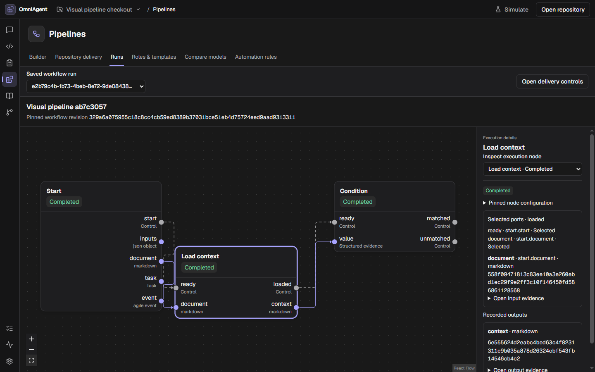

<p align="center">
  
</p>

<h1 align="center">OmniAgent</h1>

<p align="center"><strong>A Windows desktop workspace for coding agents and Git.</strong></p>

<p align="center">
  <a href="#get-started"></a>
  <a href="#project-layout"></a>
  <a href="https://github.com/LeGustaVinho/omniagent/actions/workflows/windows.yml"></a>
</p>

<p align="center">
  <a href="#why-omniagent">Why OmniAgent</a> ·
  <a href="#use-cases">Use cases</a> ·
  <a href="#features">Features</a> ·
  <a href="#get-started">Get started</a> ·
  <a href="#providers">Providers</a> ·
  <a href="#development">Development</a>
</p>

Open a Git repository, work with Codex, Claude Code, or Antigravity, and follow a change from the first conversation to the reviewed diff. OmniAgent brings agent sessions, tasks, pipelines, and Git worktrees into the same desktop workspace.

## Why OmniAgent?

A direct Codex or Claude Code session is a good fit for a quick question, a small edit, or a workflow you already run in the terminal. [Codex CLI](https://learn.chatgpt.com/docs/cli) · [Claude Code](https://code.claude.com/docs/en/overview)

Use OmniAgent when the work spans several steps you want to track together. The app runs your installed provider CLI and keeps the plan, implementation attempt, verification results, and Git change linked to the task. You can also give two providers the same prompt and committed code, or reuse a reviewed pipeline for the next task.

## Use cases

### Compare Codex and Claude Code before editing

Suppose you need to make a nullable database field required. Ask each model to reason from the same repository state and explain how it would handle existing rows and a rollback.

> Propose a two-release migration that makes this field required. Identify the code paths and tests you would update, explain the backfill order, and describe how to roll back each release.

1. Open **Pipelines → Compare models**.
2. Enter the shared request, use the current checkout's commit or supply a full commit SHA, and select at least two available models.
3. Choose **Start comparison**. Each eligible candidate receives the same request and a clean, read-only checkout at the selected commit.
4. Open the saved responses and compare how each plan handles compatibility, migration order, and tests. A candidate that fails its capability check is recorded alongside the available results.

### Build a pipeline you can run again

Create a small pipeline that loads a saved Markdown source and checks whether the resulting evidence records the source path. This is a starting point for workflows that need an explicit document input.

1. Open **Pipelines → Builder → New pipeline**. Keep the **Start** node and add **Load context** and **Condition**.
2. Connect the control and data ports below. Set the condition to check that the field path `/evidence/relativePath` exists.

   | Output port | Input port |
   | --- | --- |
   | `start.start` | `load-context.ready` |
   | `start.document` | `load-context.document` |
   | `load-context.loaded` | `condition.ready` |
   | `load-context.context` | `condition.value` |

3. Save the package revision, open **Review changes and simulate**, and supply a sample Markdown path such as `docs/release.md`. Inspect the node inputs and the `matched` output in the simulation trace.
4. Review and confirm publication. From a task's **Workflow** tab, choose **Run published workflow**, select its revision, and provide the checkout and saved source note. Open **Pipelines → Runs** later to inspect the pinned revision and recorded stage outputs.

<details>
<summary>See the completed pipeline run</summary>



</details>

### Pick up an interrupted run

If OmniAgent restarts during a task, open **Queue** and select the interrupted attempt. Review its recorded outcome and the worktree it used. If the attempt stopped during a Git write, complete the reconciliation review when prompted before retrying. To rehearse this path with example data, choose **Simulate → Recovery**, open **Queue**, and select **Resume from checkpoint**.

## Features

| Workspace | What you can do |
| --- | --- |
| **Conversations** | Stream responses, attach files or reference earlier conversations, and resume, rewind, or fork at a message. Use **Read-only**, **Plan Mode**, or **Goal Mode** where supported. |
| **Tasks** | Organize epics, tasks, and subtasks in Kanban or table views. Set dependencies and acceptance criteria, assign work by role and model, and track checklists or run them by item. |
| **Pipelines** | Build workflows with typed ports, branch conditions, approvals, and reusable nodes or subflows. Review simulations, publish revisions, and launch workflows manually or through rules on work-item events. |
| **Model comparison** | Compare models from the same provider or across providers. Review original responses, individual run states, and recorded execution details. |
| **Git** | Browse changes, worktrees, and history. Compare branches, inspect staged changes and saved attempt diffs, and review verified commits and merges. |
| **IDE** | Edit repository files in Monaco, search within the selected checkout, and run commands in the integrated terminal. |
| **Knowledge** | Read and edit repository Markdown with wikilinks, backlinks, Mermaid diagrams, and a graph of related notes. Use a saved note revision as workflow context. |
| **Queue and diagnostics** | Inspect jobs waiting on approvals, dependencies, execution slots, or a worktree writer. Open the attempt history, runtime diagnostics, or exact recorded input where available. |

## Get started

Build from source on **Windows x64** while release qualification continues. The validation report records Windows 10 22H2 installer and upgrade tests and tracks the outstanding Windows 11 and provider qualification runs. [Windows release validation](docs/windows-release-validation.md)

### Prerequisites

- Git for Windows and the Microsoft Edge WebView2 Evergreen Runtime.
- Microsoft C++ Build Tools with the **Desktop development with C++** workload and Windows SDK. [Tauri Windows setup guide](https://v2.tauri.app/start/prerequisites/#windows)
- Node.js `24.18.1`, pnpm `11.25.0`, and Rust `1.99.1` via `rustup` with the `x86_64-pc-windows-msvc` target. [Node pin](.node-version) · [pnpm pin](package.json) · [Rust toolchain](rust-toolchain.toml)
- Optional `ripgrep` (`rg`) for searching file contents in the IDE.

### Run from source

From PowerShell, clone the repository and start the desktop app. The Tauri command starts the frontend dev server and Rust runtime.

```powershell
git clone https://github.com/LeGustaVinho/omniagent.git
Set-Location omniagent
pnpm install --frozen-lockfile
pnpm tauri dev
```

### Try the sample workflows

Choose **Open repository** and select a local Git repository or worktree. Then select **Simulate** in the title bar and pick **Delivery**, **Pipelines**, or **Recovery**. These scenarios use built-in example data, so you can walk through them before signing in to a provider.

### Start a live agent session

1. Install your preferred [provider CLI](#providers) and sign in using its own flow.
2. Open **Settings → Providers** and select **Check CLI**. If the executable is outside `PATH`, enter its full path and save it first.
3. In **Conversations**, choose **New conversation**, select a provider and model, and pick a mode. For a first **Read-only** session, ask the agent to trace a code path and cite the files it inspected.

## Providers

OmniAgent sends the prompt and selected context to the provider's local CLI. The CLI manages authentication. Models, conversation modes, and effective permissions depend on the CLI version, account, and Windows host.

| Provider | Executable | Transport |
| --- | --- | --- |
| [OpenAI Codex](https://learn.chatgpt.com/docs/cli) | `codex.exe` | Codex App Server over JSON-RPC |
| [Claude Code](https://code.claude.com/docs/en/setup) | `claude.exe` | Streaming JSON |
| [Google Antigravity](https://antigravity.google/docs/install?tab=cli) | `agy.exe` | Agent Client Protocol (ACP) over stdio |

**Check CLI** reports the detected executable, version, protocol, authentication, and available permission information. Use the validation report to check the specific CLI and host combinations that have been exercised. [CLI and authentication matrix](docs/windows-release-validation.md#cli-and-authentication-matrix)

## Execution and local data

- In **Settings → Git and delivery**, choose whether commits and merges require manual action after accepting a diff. Set the completion milestone to **Verified commit** or **Verified merge**, and select a destination branch when a merge is required.
- Use **Settings → Customizations** to inspect repository instructions, hooks, skills, plugins, and MCP servers. Worktrees give tasks separate Git checkouts. Effective filesystem permissions depend on the selected mode, provider sandbox, and runner. [Startup and containment validation](docs/windows-release-validation.md#approved-startup-and-effective-containment)
- Closing the main window hides it to the Windows tray while the runtime stays active. Use **Show** to bring it back or **Exit** to shut down the app.
- Workspace state is stored in `omniagent.sqlite3` under `%LOCALAPPDATA%\io.github.legustavinho.omniagent`. Windows DPAPI protects records such as conversation drafts and exact dispatch payloads. Managed worktrees default to the profile's `worktrees` directory.
- Use **Settings → System → Backup and restore** to create a backup or stage a restore for the current installation. A staged restore takes effect on restart. [Storage and recovery details](docs/windows-release-validation.md#tray-recovery-and-storage)

## Troubleshooting

| Symptom | Where to check |
| --- | --- |
| The provider executable or models are unavailable | Check the executable path and sign-in under **Settings → Providers**, then reopen the model picker. |
| A job stays in the queue | Open **Queue**, select the job, and read its wait reason. Look for a pending approval, dependency, unavailable execution slot, or a worktree already reserved by another writer. |
| File content search is unavailable | Install `ripgrep` or set **ripgrep executable** under **Settings → System**. |
| An accepted change is still waiting for delivery | Check the commit and merge policy, completion milestone, and destination branch under **Settings → Git and delivery**. Inspect the saved candidate in **Git**. |

## Development

### Project layout

The React workbench calls the Rust backend over Tauri IPC. The runtime resolves the project, checkout, and provider profile, schedules the work, and streams results into the UI. SQLite persists job state, conversation history, and workflow revisions between launches.

| Path | Contents |
| --- | --- |
| [`src/`](src/) | React, TypeScript, and Vite frontend |
| [`src/bindings/`](src/bindings/) | TypeScript bindings generated from Rust types |
| [`src-tauri/src/`](src-tauri/src/) | Tauri commands, provider adapters, scheduling, and Git integration |
| [`src-tauri/migrations/`](src-tauri/migrations/) | SQLite schema migrations |
| [`src-tauri/tests/`](src-tauri/tests/) | Rust integration tests and provider protocol fixtures |
| [`tests/desktop/`](tests/desktop/) | Windows desktop smoke tests and installer acceptance scenarios |

### Build the Windows installer

Run this from the repository root after installing dependencies.

```powershell
node node_modules/@tauri-apps/cli/tauri.js build --target x86_64-pc-windows-msvc --bundles nsis --ci --no-sign -- --locked
```

With the default Cargo target directory, the unsigned, per-user installer is written to `src-tauri/target/x86_64-pc-windows-msvc/release/bundle/nsis/`. The bundle uses the Evergreen WebView2 download bootstrapper when the runtime is needed.

### Run the checks

The Windows fixture job checks the frontend build, Vitest suites, Rust formatting and tests, and the generated bindings. [GitHub Actions workflow](https://github.com/LeGustaVinho/omniagent/actions/workflows/windows.yml)

```powershell
pnpm build
pnpm test --pool=threads --maxWorkers=2 --testTimeout=20000
cargo fmt --all --check --manifest-path src-tauri/Cargo.toml
cargo test --locked --manifest-path src-tauri/Cargo.toml -- --test-threads=4
git diff --exit-code -- src/bindings
```

### Windows desktop smoke test

The smoke test drives the compiled app with WebDriver Classic. It uses a separate application profile, disposable Git worktrees, and scripted CLIs. The helper prepares `tauri-driver` and an Edge WebDriver matched to WebView2. Set `OMNIAGENT_TAURI_DRIVER` and `OMNIAGENT_EDGE_DRIVER` before running the helper to reuse compatible drivers.

```powershell
$drivers = ./tests/desktop/prepare-windows-drivers.ps1 -Destination (Join-Path $env:TEMP 'omniagent-webdriver')
$env:OMNIAGENT_TAURI_DRIVER = $drivers.TauriDriver
$env:OMNIAGENT_EDGE_DRIVER = $drivers.EdgeDriver
node node_modules/@tauri-apps/cli/tauri.js build --debug --no-bundle --config tests/desktop/tauri.conf.json --ci -- --locked
pnpm test:desktop
```

For installer and update acceptance tests, see the build scenarios and recorded test scope. [Windows release validation](docs/windows-release-validation.md#nsis-installation-and-upgrade)

## Contributing

For bug reports, include your Windows version, OmniAgent version or commit, steps to reproduce, and the relevant error. For a provider issue, also include the CLI version, model, and permission mode. [GitHub Issues](https://github.com/LeGustaVinho/omniagent/issues)

Attribution and license notices for adapted fixtures are listed in the [upstream notices](docs/windows-release-validation.md#upstream-notices).
