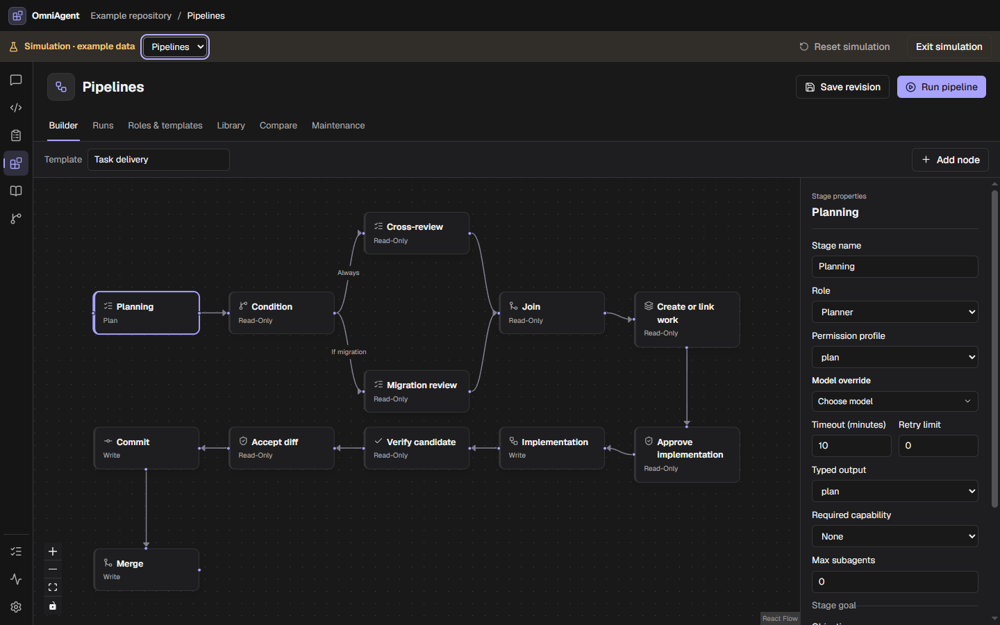

<p align="center">
  
</p>

<h1 align="center">OmniAgent</h1>

<p align="center"><strong>A Windows desktop workspace for coding agents and Git.</strong></p>

<p align="center">
  <a href="#get-started"></a>
  <a href="#project-layout"></a>
  <a href="https://github.com/LeGustaVinho/omniagent/actions/workflows/windows.yml"></a>
</p>

<p align="center">
  <a href="#features">Features</a> ·
  <a href="#get-started">Get started</a> ·
  <a href="#providers">Providers</a> ·
  <a href="#development">Development</a>
</p>

Open a Git repository, plan work with Codex, Claude Code, or Antigravity, and hand it off to a managed worktree. OmniAgent connects the conversation, task, and resulting diff so you can review how a change was made before it reaches its destination branch.



*The Task delivery pipeline in Simulate mode, using the built-in example repository.*

## Features

| Area | What you can do |
| --- | --- |
| **Agent conversations** | Stream responses, attach files, and resume or fork conversations. Use planning and goal modes with supporting providers. |
| **Task planning** | Track epics, tasks, and subtasks in Kanban and table views. Link agent work to acceptance criteria, checklists, and dependencies. |
| **Visual pipelines** | Connect reusable stages with typed ports and conditional branches. Add approval steps, simulate a workflow, and review its revision before publishing. |
| **Git delivery** | Run agent work in managed Git worktrees, verify candidate changes, review saved diffs, and control when changes are committed and merged. |
| **Model comparison** | Give multiple models the same prompt and Git snapshot. Inspect each response and its run details. |
| **Integrated IDE and Knowledge** | Edit repository files alongside a terminal. Read and edit Markdown with wikilinks, backlinks, and a note graph. |
| **Queue and recovery** | Track background jobs, see why they are blocked, and use recovery actions for interrupted attempts. |
| **Execution controls** | Configure project permissions, respond to agent questions and approval requests, and inspect the repository context and inputs recorded for a run. |

## Get started

Build from source on **Windows x64** while release qualification continues. For tested hosts, installer behavior, and provider capabilities, see the [Windows release validation report](docs/windows-release-validation.md).

### Prerequisites

- Git for Windows and the Microsoft Edge WebView2 Evergreen Runtime.
- Microsoft C++ Build Tools with the **Desktop development with C++** workload and Windows SDK. [Tauri Windows setup guide](https://v2.tauri.app/start/prerequisites/#windows)
- Node.js `24.18.1`, pnpm `11.25.0`, and Rust `1.99.1` via `rustup` with the `x86_64-pc-windows-msvc` target. [Node pin](.node-version) · [pnpm pin](package.json) · [Rust toolchain](rust-toolchain.toml)
- Optional `ripgrep` (`rg`) for searching file contents in the IDE.

### Run from source

```powershell
git clone https://github.com/LeGustaVinho/omniagent.git
Set-Location omniagent
pnpm install --frozen-lockfile
pnpm tauri dev
```

### Start your first session

1. Select **Open repository** and choose a local Git repository or worktree.
2. Install and sign in to your preferred CLI. In **Settings → Providers**, select **Check CLI**. If the executable is outside `PATH`, enter its path and save it first.
3. In **Conversations**, select **New conversation**, choose a provider and model, and send a prompt.

Select **Simulate** after opening a repository to explore the sample workflows before connecting a provider.

## Providers

OmniAgent passes prompts and selected context to the provider's local CLI. The provider manages sign-in. Available models, session modes, and permissions depend on the CLI version, account, and host.

| Provider | Executable | Transport |
| --- | --- | --- |
| [OpenAI Codex](https://learn.chatgpt.com/docs/cli) | `codex.exe` | Codex App Server over JSON-RPC |
| [Claude Code](https://code.claude.com/docs/en/setup) | `claude.exe` | Streaming JSON |
| [Google Antigravity](https://antigravity.google/docs/install?tab=cli) | `agy.exe` | Agent Client Protocol (ACP) over stdio |

## Development

### Build the Windows installer

Run this from the repository root after installing dependencies.

```powershell
node node_modules/@tauri-apps/cli/tauri.js build --target x86_64-pc-windows-msvc --bundles nsis --ci --no-sign -- --locked
```

With the default Cargo target directory, the per-user installer is written to `src-tauri/target/x86_64-pc-windows-msvc/release/bundle/nsis/`.

### Run the checks

These commands match the Windows fixture job. [GitHub Actions workflow](https://github.com/LeGustaVinho/omniagent/actions/workflows/windows.yml)

```powershell
pnpm build
pnpm test --pool=threads --maxWorkers=2 --testTimeout=20000
cargo fmt --all --check --manifest-path src-tauri/Cargo.toml
cargo test --locked --manifest-path src-tauri/Cargo.toml -- --test-threads=4
git diff --exit-code -- src/bindings
```

### Windows desktop smoke test

The smoke test uses a separate application profile, disposable Git worktrees, and scripted CLIs. The helper prepares `tauri-driver` and an Edge WebDriver matched to WebView2. To reuse existing drivers, set `OMNIAGENT_TAURI_DRIVER` and `OMNIAGENT_EDGE_DRIVER` before running it.

```powershell
$drivers = ./tests/desktop/prepare-windows-drivers.ps1 -Destination (Join-Path $env:TEMP 'omniagent-webdriver')
$env:OMNIAGENT_TAURI_DRIVER = $drivers.TauriDriver
$env:OMNIAGENT_EDGE_DRIVER = $drivers.EdgeDriver
node node_modules/@tauri-apps/cli/tauri.js build --debug --no-bundle --config tests/desktop/tauri.conf.json --ci -- --locked
pnpm test:desktop
```

### Project layout

| Path | Contents |
| --- | --- |
| [`src/`](src/) | React, TypeScript, and Vite frontend, including generated IPC bindings |
| [`src-tauri/`](src-tauri/) | Rust and Tauri runtime, CLI adapters, Git integration, and SQLite migrations |
| [`tests/desktop/`](tests/desktop/) | Windows desktop smoke tests and installer acceptance scenarios |

## Local data

The app stores workspace state in SQLite under `%LOCALAPPDATA%\io.github.legustavinho.omniagent`. Windows DPAPI protects records such as conversation drafts and exact dispatch payloads. Use **Settings → System → Backup and restore** to back up or restore data for the current installation.

## Contributing

For bug reports, include your Windows version, OmniAgent version or commit, and steps to reproduce. For CLI issues, include the provider and executable version. [GitHub Issues](https://github.com/LeGustaVinho/omniagent/issues)

Attribution and license notices for adapted fixtures are listed in the [upstream notices](docs/windows-release-validation.md#upstream-notices).
