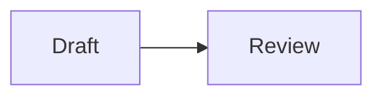

# Compatibility check 🚀

Read **the fixture** and [[./details#Evidence|open the reference]].

> [!NOTE] Calibration
> The reading stays linked to its evidence.

Inline area $a^2$.

$$
\frac{1}{2}
$$

- [ ] Review the table
- [/] Keep the custom state 📅 2026-11-27

| Check | Result |
| :--- | ---: |
| Start | Pending |

![[./details#Evidence]]

Read the tolerance.[^tolerance]

[^tolerance]: Measured on this fixture.
